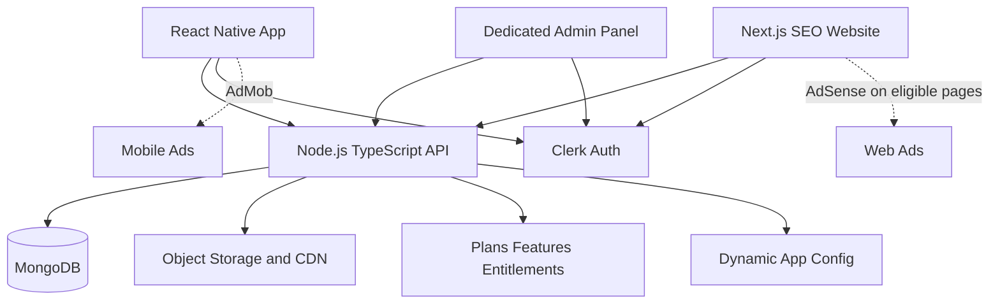

# System Architecture

## Proposed stack
- Mobile: React Native + TypeScript; decide Expo or Community CLI before scaffolding.
- Web: Next.js + TypeScript, SSR/SSG for public property pages.
- Admin: protected responsive web panel, preferably an isolated route group/layout in the web workspace.
- Auth: Clerk; API verifies Clerk-issued tokens and maps Clerk user IDs to application users and roles.
- Backend: Node.js + TypeScript; choose NestJS or Express before implementation.
- Database: MongoDB Atlas/managed MongoDB.
- Media: object storage + CDN; store metadata, not media binaries, in MongoDB.
- Maps: provider abstraction; verify pricing and licensing.
- Ads: AdMob for native app, AdSense for eligible web pages.

## Dynamic configuration
API supplies active categories, home sections, filters, feature flags, ad placement configuration and user entitlements. Do not hardcode business configuration in clients. Static design assets, safe fallbacks and type-safe system enums are acceptable.

## Security
Clerk authenticates identity; backend authorizes role and ownership. Never trust client-sent role, user ID, plan or entitlement claims. Admin roles are granted server-side and audited.

## Scale
Start with a modular monolith and managed services. Add queues/cache/dedicated search only when metrics justify them. Avoid microservices and Kubernetes by default.
