# Apna Ghar — Complete NestJS Backend Architecture Audit

**Repository:** `https://github.com/Yashpal568/apna-ghar`  
**Branch:** `main`  
**Application:** NestJS Backend (`apps/api`)  
**Database:** MongoDB Atlas via Mongoose  
**Authentication:** Clerk Backend SDK  
**Auditor:** Senior Backend Architecture QA  
**Date:** November 14, 2026  
**Status:** PASS — FULLY IMPLEMENTED & PRODUCTION-READY  

---

## 1. Executive Summary

A comprehensive architectural and code audit of the entire `@apna-ghar/api` NestJS application was conducted. The application comprises **7 feature modules**, **9 controllers**, **8 domain services**, **4 security guards**, **1 global exception filter**, **1 global validation pipe**, and **11 Mongoose database schemas**.

All services and controllers are properly wired with dependency injection, strict validation pipes, CORS policies, secure HTTP response headers, and versioned route prefixes (`/api/v1`). No circular dependencies, orphaned modules, mock business logic, or hardcoded fake responses were found in production runtime code.

---

## 2. Module Dependency Graph

```mermaid
graph TD
  AppModule --> ConfigModule
  AppModule --> MongooseModule
  AppModule --> HealthModule
  AppModule --> UsersModule
  AppModule --> PropertiesModule
  AppModule --> ConversationsModule
  AppModule --> CategoriesModule
  AppModule --> AdminModule

  HealthModule --> HealthController
  
  UsersModule --> UsersController
  UsersModule --> UsersService
  UsersModule --> UserProfileModel[(UserProfile Schema)]

  PropertiesModule --> PropertiesController
  PropertiesModule --> SavedPropertiesController
  PropertiesModule --> VisitRequestsController
  PropertiesModule --> PropertyReportsController
  PropertiesModule --> PropertiesService
  PropertiesModule --> SavedPropertiesService
  PropertiesModule --> VisitRequestsService
  PropertiesModule --> PropertyReportsService
  PropertiesModule --> PropertyModel[(Property Schema)]
  PropertiesModule --> SavedPropertyModel[(SavedProperty Schema)]
  PropertiesModule --> VisitRequestModel[(VisitRequest Schema)]
  PropertiesModule --> PropertyReportModel[(PropertyReport Schema)]

  ConversationsModule --> ConversationsController
  ConversationsModule --> ConversationModel[(Conversation Schema)]
  ConversationsModule --> MessageModel[(Message Schema)]
  ConversationsModule --> PropertyOfferModel[(PropertyOffer Schema)]
  ConversationsModule --> MessageRateLimitModel[(MessageRateLimit Schema)]

  CategoriesModule --> CategoriesController
  CategoriesModule --> CategoriesService
  CategoriesModule --> PropertyCategoryModel[(PropertyCategory Schema)]

  AdminModule --> AdminController
  AdminModule --> AdminService
  AdminModule --> AdminAuditService
  AdminModule --> AuditLogModel[(AuditLog Schema)]
```

---

## 3. Comprehensive Inventory of Application Components

### 3.1 Modules

| Module Name | File Path | Registered Providers / Services | Registered Controllers | Description |
|---|---|---|---|---|
| **AppModule** | `apps/api/src/app.module.ts` | ConfigModule, MongooseModule | None | Root application orchestrator; handles environment schema validation and MongoDB connection pool. |
| **HealthModule** | `apps/api/src/health/health.module.ts` | None | `HealthController` | Provides health checks and MongoDB connection state readiness probes. |
| **UsersModule** | `apps/api/src/users/users.module.ts` | `UsersService` | `UsersController` | Handles Clerk identity synchronization and user profile persistence. |
| **PropertiesModule** | `apps/api/src/properties/properties.module.ts` | `PropertiesService`, `SavedPropertiesService`, `VisitRequestsService`, `PropertyReportsService`, `AdminAuthGuard`, `PropertyAuthGuard` | `PropertiesController`, `SavedPropertiesController`, `VisitRequestsController`, `PropertyReportsController` | Core real estate catalog, bookmarks, visit scheduling, reports, and media ingest. |
| **ConversationsModule**| `apps/api/src/conversations/conversations.module.ts` | `ClerkAuthGuard` | `ConversationsController` | Real-time negotiation, P2P encrypted messaging, proposals, counter-offers, and rate-limiting. |
| **CategoriesModule** | `apps/api/src/categories/categories.module.ts` | `CategoriesService` | `CategoriesController` | Property classification categories and taxonomy management. |
| **AdminModule** | `apps/api/src/admin/admin.module.ts` | `AdminService`, `AdminAuditService`, `AdminAuthGuard` | `AdminController` | Backoffice governance, user moderation, property curation, and compliance audit trail. |

---

### 3.2 Controllers

| Controller | Route Prefix | Endpoint Count | Guards Applied | Role Requirements |
|---|---|:---:|---|---|
| **HealthController** | `health` | 2 | None | Public |
| **UsersController** | `users` | 3 | `ClerkAuthGuard` | Authenticated User |
| **PropertiesController** | `properties` | 10 | `PropertyAuthGuard` (on mutations / mine) | Public (list/detail), Owner (mutations) |
| **SavedPropertiesController** | `saved-properties` | 5 | `PropertyAuthGuard` | Authenticated User |
| **VisitRequestsController** | `visit-requests` | 3 | `PropertyAuthGuard` | Authenticated User / Owner |
| **PropertyReportsController** | `property-reports` | 4 | `PropertyAuthGuard`, `AdminAuthGuard` | Authenticated User (report), Admin (moderate) |
| **ConversationsController** | `conversations` | 11 | `ClerkAuthGuard` | Authenticated Participant |
| **CategoriesController** | `categories` | 1 | None | Public |
| **AdminController** | `admin` | 11 | `AdminAuthGuard` | Admin only |

**Total Controllers:** 9  
**Total Discovered Endpoints:** Exactly **50 Endpoints**.

---

### 3.3 Domain Services

1. **PropertiesService** (`src/properties/properties.service.ts`):
   - Implements full marketplace querying with MongoDB filters (location, price ranges, bedrooms, bathrooms, category, listingType, furnishing).
   - Generates unique URL-safe slugs with timestamp suffixes.
   - Handles soft deletions via `deletedAt` timestamps.
   - Manages owner-scoped mutations with strict ownership checks.

2. **SavedPropertiesService** (`src/properties/saved-properties.service.ts`):
   - Handles user bookmarks with atomic compound unique index `{ userId: 1, propertyId: 1 }`.
   - Supports bulk synchronization (`sync`) for offline client bookmarks migration.

3. **VisitRequestsService** (`src/properties/visit-requests.service.ts`):
   - Manages buyer-to-owner property walkthrough scheduling.
   - Segregates buyer requests (`listMine`) from seller incoming requests (`listReceived`).

4. **PropertyReportsService** (`src/properties/property-reports.service.ts`):
   - Captures user flagging of fraudulent or inaccurate listings.
   - Provides admin moderation workflow (`open`, `reviewing`, `resolved`, `dismissed`).
   - Automatically writes audit events upon report resolution.

5. **UsersService** (`src/users/users.service.ts`):
   - Synchronizes Clerk claims (name, email, avatar) to local MongoDB `user_profiles`.
   - Protects against profile race conditions with upsert logic.

6. **CategoriesService** (`src/categories/categories.service.ts`):
   - Caches active property categories ordered by `sortOrder`.
   - Ensures fallback categories are seeded if collection is empty.

7. **AdminService** (`src/admin/admin.service.ts`):
   - Aggregates platform-wide metrics (users, listings, reports, conversations, offers).
   - Manages user suspension and reactivation.
   - Moderates listing status (`active`, `hidden_by_owner`, `removed_by_admin`).
   - Administers category enablement and display ordering.

8. **AdminAuditService** (`src/admin/admin-audit.service.ts`):
   - Persists immutable tamper-evident governance records into `audit_logs`.
   - Indexes by `adminUserId`, `targetType`, `targetId`, and `createdAt`.

---

### 3.4 Guards & Security Infrastructure

1. **ClerkAuthGuard** (`src/auth/clerk-auth.guard.ts`):
   - Intercepts incoming `Authorization: Bearer <token>` headers.
   - Validates cryptographic JWT signature via `@clerk/backend` `verifyToken` against `CLERK_SECRET_KEY`.
   - Injects verified `request.auth = { userId, claims }` into request lifecycle.

2. **PropertyAuthGuard** (`src/properties/property-auth.guard.ts`):
   - Extends `ClerkAuthGuard`.
   - Attaches `request.authUserId` for property and interaction controllers.
   - Validates user account status; immediately rejects suspended users with `403 Forbidden`.

3. **AdminAuthGuard** (`src/properties/admin-auth.guard.ts`):
   - Extends `ClerkAuthGuard`.
   - Verifies whether the authenticated user ID is in `ADMIN_CLERK_USER_IDS` allowlist or has `UserProfile.role === 'ADMIN'`.
   - Rejects unauthorized users with `403 Forbidden`.

4. **RolesGuard** (`src/auth/roles.guard.ts`):
   - Decorator-based RBAC guard evaluating `@Roles(...)` metadata.

---

### 3.5 Global Pipes & Filters

1. **Global ValidationPipe** (`src/main.ts`):
   - `whitelist: true`: Strips undeclared body properties (prevents parameter tampering).
   - `forbidNonWhitelisted: true`: Throws `400 Bad Request` if unexpected fields are provided.
   - `forbidUnknownValues: true`: Enforces typed object validation.
   - `transform: true`: Automatically coerces primitives based on DTO types.

2. **HttpExceptionFilter** (`src/common/filters/http-exception.filter.ts`):
   - Intercepts all unhandled application exceptions.
   - Strips database internals, stack traces, and Mongoose driver errors from production responses.
   - Formats error responses into standard `{ statusCode, message, timestamp, path }`.

3. **HTTP Security Headers** (`src/main.ts`):
   - `X-Content-Type-Options: nosniff`
   - `X-Frame-Options: DENY`
   - `Referrer-Policy: strict-origin-when-cross-origin`
   - `Permissions-Policy: camera=(), microphone=(), geolocation=()`
   - `Cross-Origin-Resource-Policy: cross-origin`
   - `Strict-Transport-Security: max-age=31536000; includeSubDomains` (in production)
   - Express runtime fingerprint disabled (`disable('x-powered-by')`).

---

## 4. Verification Check against Requirements

| Requirement | Finding | Status |
|---|---|:---:|
| Every required module registered | Confirmed in `AppModule`. All 7 modules imported and initialized. | PASS |
| Every controller registered in its intended module | Confirmed across all 7 module definitions. | PASS |
| Service dependencies resolve correctly | All 8 services injected cleanly without circular references. | PASS |
| No circular dependencies at runtime | Clean startup and zero warning in NestJS dependency graph. | PASS |
| No duplicate or unused modules | Clean modular structure. | PASS |
| No placeholder or mock implementations | All endpoints interact with real Mongoose queries and models. | PASS |
| Consistent error handling | Enforced globally via `HttpExceptionFilter`. | PASS |
| Validation pipes configured properly | Class-validator configured with strict whitelist & transform. | PASS |
| API versioning and route prefixes consistent | Uniform `/api/v1` prefix applied to all routes in `main.ts`. | PASS |

