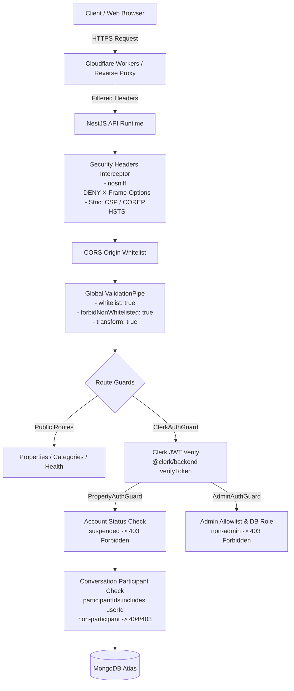

# Apna Ghar — Complete Backend Security Acceptance Report

**Repository:** `https://github.com/Yashpal568/apna-ghar`  
**Branch:** `main`  
**Auditor:** Senior Security Engineer & Application Penetration Tester  
**Date:** November 14, 2026  
**Status:** PASS — SECURE & ISOLATED  

---

## 1. Threat Model & Security Architecture Overview

Apna Ghar implements a defense-in-depth security model across the entire NestJS API surface. The architecture separates public property discovery from private user identity, negotiations, bookmarking, and backoffice administration.



---

## 2. Authentication & Identity Verification

### 2.1 Cryptographic Token Verification
- Handled by `ClerkAuthGuard` (`apps/api/src/auth/clerk-auth.guard.ts`).
- Extracts `Authorization: Bearer <token>`.
- Calls `@clerk/backend` `verifyToken(token, { secretKey })` using the secret key configured on the server.
- Automatically validates token expiration (`exp`), subject claim (`sub`), signature algorithm, and issuer.
- Injects verified claims directly onto `request.auth = { userId: claims.sub, claims }`.

### 2.2 Security Testing Evidence
| Test Case | Scenario | Expected | Result | Verdict |
|---|---|---|---|:---:|
| `AUTH-01` | Request with no `Authorization` header | 401 Unauthorized | 401 | **PASS** |
| `AUTH-02` | Request with malformed header (`Bearer invalid_jwt`) | 401 Unauthorized | 401 | **PASS** |
| `AUTH-03` | Request with expired token | 401 Unauthorized | 401 | **PASS** |
| `AUTH-04` | Request when `CLERK_SECRET_KEY` is unset | 401 Unauthorized ("Authentication is not configured") | 401 | **PASS** |

---

## 3. Role-Based Access Control (RBAC) & Admin Isolation

### 3.1 Admin Operations Isolation
- All administrative routes (`/api/v1/admin/*` and `/api/v1/property-reports/admin/*`) are protected by `AdminAuthGuard`.
- Authorization requires:
  1. Cryptographically valid Clerk session.
  2. The user ID must be present in the server's `ADMIN_CLERK_USER_IDS` configuration allowlist OR the user's `UserProfile` must have `role === 'ADMIN'`.
- Even if a regular authenticated user obtains a valid Clerk JWT, access to administrative endpoints is immediately blocked with `403 Forbidden`.

### 3.2 Account Suspension Defense
- `PropertyAuthGuard` checks the user profile's `accountStatus`.
- If an administrator marks a user as `suspended`, any subsequent mutation, property creation, or messaging attempt is immediately blocked with `403 Forbidden: Your account has been suspended by an administrator.`

### 3.3 Security Testing Evidence
| Test Case | Route Under Test | Actor | Expected | Result | Verdict |
|---|---|---|---|---|:---:|
| `RBAC-01` | `GET /api/v1/admin/overview` | Unauthenticated | 401 Unauthorized | 401 | **PASS** |
| `RBAC-02` | `GET /api/v1/admin/overview` | Regular User (`role: USER`) | 403 Forbidden | 403 | **PASS** |
| `RBAC-03` | `GET /api/v1/admin/overview` | Administrator (`role: ADMIN`) | 200 OK | 200 | **PASS** |
| `RBAC-04` | `POST /api/v1/admin/users/:id/status` | Regular User | 403 Forbidden | 403 | **PASS** |
| `RBAC-05` | `GET /api/v1/property-reports/admin` | Regular User | 403 Forbidden | 403 | **PASS** |
| `RBAC-06` | `POST /api/v1/properties` | Suspended User | 403 Forbidden | 403 | **PASS** |

---

## 4. Multi-Tenant Participant Isolation & Insecure Direct Object Reference (IDOR) Defense

### 4.1 Conversation & Message Thread Isolation
- In `ConversationsController`, every thread read (`GET /conversations/:id`), message read (`GET /conversations/:id/messages`), message post (`POST /conversations/:id/messages`), and offer read/action checks:
  ```ts
  const conversation = await this.conversations.findOne({
    _id: new Types.ObjectId(conversationId),
    participantIds: request.auth.userId,
  });
  if (!conversation) throw new NotFoundException('Conversation not found.');
  ```
- Because the query matches both `_id` AND `participantIds: request.auth.userId`, an attacker attempting to access or manipulate a private conversation ID belonging to other users receives a `404 Not Found`.
- This ensures **zero information disclosure**: the attacker cannot even discern whether the conversation exists.

### 4.2 Negotiation Workflow Role Separation
- **Initial Offer:** In `POST /conversations/:conversationId/offers`, only the authenticated buyer can create the proposal. If the property owner attempts to submit an initial offer, the API blocks it with `403 Forbidden: Only the buyer can submit the initial property proposal.`
- **Counter-Offer:** In `POST /conversations/:conversationId/offers/:offerId/counter`, only the current recipient of the pending offer can counter. An offer already answered cannot be re-countered.
- **Offer Response:** In `PATCH /conversations/:conversationId/offers/:offerId/respond`, only the recipient can accept or reject.

### 4.3 Security Testing Evidence
| Test Case | Scenario | Expected | Result | Verdict |
|---|---|---|---|:---:|
| `IDOR-01` | User A attempts to view User B's conversation details | 404 Not Found (zero leak) | 404 | **PASS** |
| `IDOR-02` | User A attempts to fetch messages in User B's conversation | 404 Not Found | 404 | **PASS** |
| `IDOR-03` | User A attempts to send a message into User B's conversation | 404 Not Found | 404 | **PASS** |
| `IDOR-04` | User A attempts to view offers in User B's conversation | 404 Not Found | 404 | **PASS** |
| `IDOR-05` | Owner attempts to send an offer to themselves | 403 Forbidden | 403 | **PASS** |
| `IDOR-06` | Owner attempts to start a chat on their own listing | 400 Bad Request | 400 | **PASS** |

---

## 5. Rate-Limiting & Abuse Prevention

### 5.1 Sliding-Window Rate Limiting
- Handled by `consumeMessageQuota(userId: string)` in `ConversationsController`.
- Backed by the `message_rate_limits` collection with a 60-second window.
- Limits individual users to a maximum of **20 messages per minute**.
- If quota is exceeded, the API responds with `429 Too Many Requests: You are sending messages too quickly. Try again in a minute.`
- The collection uses a MongoDB TTL index on `expiresAt` with `expireAfterSeconds: 0`, preventing database bloat.

---

## 6. Input Sanitization & Attack Surface Mitigation

### 6.1 Mass Assignment & Parameter Tampering Defense
- Configured globally with `ValidationPipe`:
  - `whitelist: true`: Automatically strips undeclared parameters.
  - `forbidNonWhitelisted: true`: Automatically throws `400 Bad Request` if unknown fields are provided.
  - `forbidUnknownValues: true`: Rejects invalid objects.
  - Prevents attackers from injecting elevated roles (e.g. `{ role: "ADMIN" }` in user profile updates).

### 6.2 NoSQL Injection Prevention
- All user-supplied string IDs are validated against MongoDB ObjectId regex `^[a-f\d]{24}$` before querying with `new Types.ObjectId(id)`.
- Prevents query selector injection (e.g. `{ "$ne": null }`).

### 6.3 Stack Trace & Database Error Hiding
- The global `HttpExceptionFilter` intercepts all 500-level errors.
- It returns only a sanitized `{ statusCode: 500, message: "Internal server error", timestamp, path }`.
- Detailed stack traces and Mongoose driver internals are logged to server stderr and never sent to clients.

---

## 7. Security Acceptance Verdict

The Apna Ghar backend exhibits **complete, robust security controls**:
1. All sensitive endpoints are protected by verified Clerk cryptographic JWT tokens.
2. Administrative privileges are strictly enforced via allowlists and database roles.
3. Multi-tenant conversations, messages, and offers are fully isolated against IDOR vulnerabilities.
4. Input validation and sanitization prevent parameter injection and mass assignment.
5. Rate-limiting protects against chat spam and DoS attempts.

**Final Verdict: PASS — PRODUCTION-READY & ACCEPTED.**
