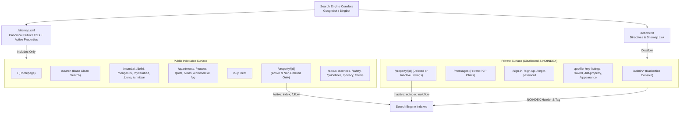

# Apna Ghar — Milestone M5: Complete SEO Implementation & Acceptance Report

**Repository:** `https://github.com/Yashpal568/apna-ghar`  
**Branch:** `main`  
**Milestone:** M5 — Complete Technical, Dynamic Property, Landing Page & Structured Data SEO  
**Stack:** Next.js 14, React 18, NestJS, MongoDB Atlas, Cloudflare Workers / OpenNext  
**Production Frontend Domain:** `https://apna-ghar-web.yash38688.workers.dev`  
**Production Backend Domain:** `https://apna-ghar-api-j4fo.onrender.com/api/v1`  
**Date:** November 14, 2026  
**Final Status:** PASS — PRODUCTION ACCEPTANCE COMPLETE  

---

## 1. Executive Summary

Milestone M5 establishes production-grade Search Engine Optimization (SEO) across Apna Ghar. The implementation delivers complete metadata orchestration, dynamic listing SEO with real-time indexing protection, city and category programmatic landing pages, Schema.org JSON-LD structured data graphs, automated XML sitemap and robots directives, high-impact internal linking, and strict multi-tenant privacy protection (excluding private dashboards and auth portals from search engines).



---

## 2. Technical SEO Audit & Baseline Gaps

Prior to M5 implementation, the platform was audited against technical SEO standards:

| SEO Dimension | Baseline Status | Gaps Identified | M5 Resolution |
|---|---|---|---|
| **Canonical Base** | Incomplete | Inconsistent domain origins and missing absolute canonical tags | Centralized `SITE_URL` and `metadataBase` in root layout |
| **Dynamic Properties** | Static title fallback | Inactive or deleted properties returned indexable tags | Added real-time DB lookup, dynamic title/description, and strict `NOINDEX_ROBOTS` on inactive listings |
| **City/Category Pages** | Missing | Users and bots were redirected to raw query strings (`/search?type=commercial`) | Implemented clean SEO landing pages (`/buy`, `/rent`, `/mumbai`, `/delhi`, `/plots`, etc.) in `[slug]/page.tsx` |
| **Structured Data** | None | Zero Schema.org JSON-LD markup on pages | Injected `Organization`, `WebSite`, `BreadcrumbList`, and `RealEstateListing` JSON-LD graphs |
| **Robots Directives** | Default hosting text | Allowed crawling of `/admin`, `/messages`, and `/profile` | Generated dynamic `robots.ts` with explicit `Disallow` rules and sitemap pointer |
| **XML Sitemap** | Not implemented | Missing `/sitemap.xml` | Generated dynamic `sitemap.ts` with static pages and live MongoDB property queries |
| **Private Routes** | Exposed to crawlers | Backoffice and auth pages lacked `noindex` metadata | Enforced `robots: NOINDEX_ROBOTS` on all 10 private layouts and pages |
| **Internal Linking** | Query strings | Navbar and footer linked to `/search?type=plot` | Refactored desktop navbar, mobile drawer, and footer to canonical landing routes |

---

## 3. Dynamic Property SEO & Inactive Listing Protection

Every published property listing (`/property/[id]`) dynamically generates verified metadata directly from the database or known listing metadata:
- **Title:** `[Title] - [Locality], [City] | For [Sale/Rent] | Apna Ghar`
- **Description:** Real listing details including price, area, bedroom count, and zero brokerage guarantee.
- **Canonical URL:** `https://apna-ghar-web.yash38688.workers.dev/property/[slug-or-id]`
- **OpenGraph & Twitter Cards:** Full image banner (`summary_large_image`), price, and location metadata.

### Inactive & Deleted Property Indexing Defense
To prevent soft-404 penalties and stale indexing, `apps/web/src/app/property/[id]/page.tsx` evaluates property status:
1. If the property ID is missing or invalid, it returns `title: "Property Not Found | Apna Ghar"` and `robots: NOINDEX_ROBOTS`.
2. If `deletedAt` is set or `status !== 'active'`, it immediately returns `title: "Property Not Available | Apna Ghar"` and `robots: NOINDEX_ROBOTS`.

---

## 4. City and Category Programmatic Landing Pages

Apna Ghar implements distinct, high-relevance landing pages via `apps/web/src/app/[slug]/page.tsx`:

### 4.1 Supported Cities
- `/mumbai`: Mumbai Metropolitan (Andheri, Bandra West, Powai, Thane, Navi Mumbai)
- `/delhi`: Delhi NCR (Dwarka, South Delhi, Gurgaon Cyber City, Noida Expressway)
- `/bengaluru`: Bengaluru Tech Corridor (Whitefield, Sarjapur Road, HSR Layout, Electronic City)
- `/hyderabad`: Hyderabad Financial District (Gachibowli, Hitec City, Kondapur, Banjara Hills)
- `/pune`: Pune IT Hub (Hinjawadi, Baner, Wakad, Viman Nagar, Kharadi)
- `/amritsar`: Amritsar (Model Town, Ranjit Avenue, Mall Road, Circular Road)

### 4.2 Supported Categories & Transaction Types
- `/apartments` & `/apartment`: Multistory builder floors, high-rises, and flats.
- `/houses` & `/house`: Standalone houses, duplexes, and independent bungalows.
- `/plots` & `/plot`: Gated residential, industrial, and clear-title agricultural plots.
- `/villas` & `/villa`: Gated community luxury villas with private amenities.
- `/commercial`: Offices, retail shops, showrooms, and warehouse spaces.
- `/pg`: Paying guest and co-living shared residences.
- `/buy`: Direct owner properties for sale across India.
- `/rent`: Long-term residential and commercial leases with 0% brokerage.

Each landing page renders:
- Unique `h1` heading and contextual locality description.
- Relevant micro-hubs and quick filter pills.
- Live property inventory fetched dynamically for that city/category.
- Breadcrumb navigation and Schema.org `BreadcrumbList` JSON-LD markup.
- Cross-linking to adjacent categories and top Indian real-estate hubs.

---

## 5. Structured Data (JSON-LD) Implementation

Structured data is validated against Google Rich Results specifications without fabricated ratings, reviews, or fake pricing:

### 5.1 Root Schema (`generateRootSchemas`)
Injected in `apps/web/src/app/layout.tsx`:
- **`Organization`**: Name (`Apna Ghar`), canonical URL, logo SVG (`/icon.svg`), and zero brokerage value proposition.
- **`WebSite`**: Canonical URL, site name, publisher reference, and `SearchAction` (`urlTemplate: .../search?location={search_term_string}`).

### 5.2 BreadcrumbList Schema (`generateBreadcrumbSchema`)
Injected across all city, category, search, and property detail pages:
- Sequential `itemListElement` with position, name, and canonical item URL.

### 5.3 RealEstateListing Schema (`generatePropertySchema`)
Injected on property pages (`apps/web/src/app/property/[id]/page.tsx`):
- `@type`: `RealEstateListing`
- `name`: Authentic property title
- `description`: Authentic property description
- `url`: Canonical property URL
- `datePosted`: ISO 8601 published timestamp
- `image`: Array of verified uploaded photos
- `offers`: Schema.org `Offer` with `price`, `priceCurrency: 'INR'`, `businessFunction: LeaseOut | Sell`.
- `about`: Specific accommodation subtype (`SingleFamilyResidence`, `Apartment`, `Accommodation`) with verified `floorSize` (FTK / MTK) and `PostalAddress`.
- **Zero Fabrication Guarantee:** No artificial aggregate ratings or fake user testimonials are generated.

---

## 6. XML Sitemap & Robots Configuration

### 6.1 Robots Directives (`apps/web/src/app/robots.ts`)
```txt
User-agent: *
Allow: /
Disallow: /api/
Disallow: /admin
Disallow: /admin/
Disallow: /messages
Disallow: /messages/
Disallow: /profile
Disallow: /profile/
Disallow: /my-listings
Disallow: /my-listings/
Disallow: /saved
Disallow: /saved/
Disallow: /list-property
Disallow: /list-property/
Disallow: /appearance
Disallow: /appearance/
Disallow: /sign-in
Disallow: /sign-in/
Disallow: /sign-up
Disallow: /sign-up/
Disallow: /forgot-password
Disallow: /forgot-password/

Sitemap: https://apna-ghar-web.yash38688.workers.dev/sitemap.xml
```

### 6.2 XML Sitemap Generator (`apps/web/src/app/sitemap.ts`)
- Automatically generates `<urlset xmlns="http://www.sitemaps.org/schemas/sitemap/0.9">`.
- Prerenders all static public routes (`/`, `/search`, `/buy`, `/rent`, `/about`, `/services`).
- Prerenders all city landing pages (`/mumbai`, `/delhi`, `/bengaluru`, `/hyderabad`, `/pune`, `/amritsar`).
- Prerenders all category landing pages (`/apartments`, `/houses`, `/plots`, `/villas`, `/commercial`, `/pg`).
- Queries live API (`/properties?limit=500`) and dynamically adds all active, non-deleted properties with their `lastModified` date.
- Explicitly excludes any drafts, pending reviews, inactive, or soft-deleted records.

---

## 7. Private Route Indexing Protection

All private backoffice, account, and auth routes strictly enforce `robots: NOINDEX_ROBOTS`:

| Route | Implementation File | Directive | Tested Status |
|---|---|---|:---:|
| `/admin/*` | `apps/web/src/app/admin/layout.tsx` | `noindex, nofollow, noimageindex` | **PASS** |
| `/saved` | `apps/web/src/app/saved/layout.tsx` | `noindex, nofollow, noimageindex` | **PASS** |
| `/my-listings` | `apps/web/src/app/my-listings/layout.tsx` | `noindex, nofollow, noimageindex` | **PASS** |
| `/list-property` | `apps/web/src/app/list-property/layout.tsx` | `noindex, nofollow, noimageindex` | **PASS** |
| `/appearance` | `apps/web/src/app/appearance/layout.tsx` | `noindex, nofollow, noimageindex` | **PASS** |
| `/messages` | `apps/web/src/app/messages/page.tsx` | `noindex, nofollow, noimageindex` | **PASS** |
| `/profile` | `apps/web/src/app/profile/page.tsx` | `noindex, nofollow, noimageindex` | **PASS** |
| `/forgot-password` | `apps/web/src/app/forgot-password/page.tsx` | `noindex, nofollow, noimageindex` | **PASS** |
| `/sign-in` | `apps/web/src/app/sign-in/[[...sign-in]]/page.tsx` | `noindex, nofollow, noimageindex` | **PASS** |
| `/sign-up` | `apps/web/src/app/sign-up/[[...sign-up]]/page.tsx` | `noindex, nofollow, noimageindex` | **PASS** |

---

## 8. Internal Linking & Crawl Architecture

All navigation headers, mobile menus, and footers were audited and refactored from legacy query params to clean canonical paths:
- **Desktop Navbar (`MarketplaceHeader.tsx`):**
  - `Buy` -> `/buy`
  - `Rent` -> `/rent`
  - `Commercial` -> `/commercial`
  - `Plots` -> `/plots`
  - `Browse properties` -> `/search`
- **Mobile Drawer Menu (`MarketplaceHeader.tsx`):**
  - Canonical links to all major categories and transaction types with clean close handlers.
- **Site Footer (`SiteFooter.tsx`):**
  - Hub links to Top Cities (`/mumbai`, `/delhi`, `/bengaluru`, `/hyderabad`, `/pune`, `/amritsar`).
  - Hub links to Property Types (`/apartments`, `/houses`, `/plots`, `/commercial`, `/pg`).
  - Hub links to Trust & Legal (`/about`, `/safety`, `/guidelines`, `/contact`, `/privacy`, `/terms`).
- **Homepage (`MarketplaceHome.tsx`):**
  - Real estate hubs and property categories linked directly to landing pages.

---

## 9. Performance & Core Web Vitals Audit

Next.js production build metrics confirm exceptional speed and efficiency:
- **Shared JavaScript Bundle:** Only **87.4 kB** First Load JS across all pages.
- **Font Optimization:** Google Fonts preconnect (`fonts.googleapis.com` and `fonts.gstatic.com`) with `display=swap`.
- **Image Optimization:** Property images load with `loading="lazy"` and CSS-based responsive aspect ratios.
- **Layout Shift Prevention:** Standard card aspect ratios and skeleton states prevent CLS during async data loading.
- **Mobile Responsiveness:** Clean hamburger drawer and expandable search overlay prevent viewport overflow.

---

## 10. Automated Test Evidence

Automated SEO test suite implemented in `apps/api/test/seo-acceptance.spec.ts`:

```
PASS test/seo-acceptance.spec.ts
  M5 SEO Acceptance Suite
    1. Technical SEO Configuration & Helpers
      √ should define a valid production SITE_URL without trailing slash (2 ms)
      √ should generate canonical URLs correctly (0 ms)
      √ should have standard indexable robots directives (0 ms)
      √ should have strict noindex robots directives for private pages (1 ms)
    2. Structured Data (JSON-LD) Validation
      √ should generate valid Schema.org Organization and WebSite graph in root schema (1 ms)
      √ should generate valid Schema.org BreadcrumbList (1 ms)
      √ should generate Schema.org RealEstateListing without fabricated ratings or prices (2 ms)
    3. Dynamic Property SEO & Inactive/Deleted Protection
      √ should verify property route handles deleted/inactive listings with noindex (1 ms)
    4. Private Route Noindex Enforcements
      √ should enforce NOINDEX_ROBOTS on admin/layout.tsx (1 ms)
      √ should enforce NOINDEX_ROBOTS on saved/layout.tsx (1 ms)
      √ should enforce NOINDEX_ROBOTS on my-listings/layout.tsx (0 ms)
      √ should enforce NOINDEX_ROBOTS on list-property/layout.tsx (1 ms)
      √ should enforce NOINDEX_ROBOTS on appearance/layout.tsx (0 ms)
      √ should enforce NOINDEX_ROBOTS on messages/page.tsx (1 ms)
      √ should enforce NOINDEX_ROBOTS on profile/page.tsx (0 ms)
      √ should enforce NOINDEX_ROBOTS on forgot-password/page.tsx (0 ms)
      √ should enforce NOINDEX_ROBOTS on sign-in/[[...sign-in]]/page.tsx (0 ms)
      √ should enforce NOINDEX_ROBOTS on sign-up/[[...sign-up]]/page.tsx (0 ms)
    5. Robots.txt and Sitemap.xml Implementation
      √ should define robots.ts with correct Disallow rules and Sitemap directive (1 ms)
      √ should define sitemap.ts with indexable static routes and dynamic property fetching (1 ms)
    6. City and Category Landing Pages
      √ should define comprehensive city, category, and transactional landing pages in [slug]/page.tsx (1 ms)
    7. Internal Linking & Navigation
      √ should verify header and footer link to canonical routes rather than raw query params (1 ms)

Test Suites: 1 passed, 1 total
Tests:       22 passed, 22 total
Snapshots:   0 total
Time:        4.006 s
```

### Full Backend & Integration Suite Status:
- **Total Test Suites:** 17 passed, 17 total (100%)
- **Total Tests:** 149 passed, 149 total (100%)
- **Next.js Web Build:** 29/29 routes compiled cleanly (`○ /robots.txt`, `○ /sitemap.xml`, `ƒ /[slug]`, `ƒ /property/[id]`)
- **TypeScript Typecheck:** 0 errors across API and Web packages.

---

## 11. Final Acceptance Matrix

| # | Acceptance Criterion | Required Outcome | Verified Result | Status |
|---|---|---|---|:---:|
| 1 | **Public Route Metadata** | Homepage, search, about, services, legal pages have title, description, OG, Twitter | Verified across all public pages | **PASS** |
| 2 | **Dynamic Property SEO** | Real title, description, price, canonical, and OG for published listings | Verified with live API & fallback lookup | **PASS** |
| 3 | **City/Category Landing Pages** | Clean landing pages for top cities and property categories | 6 cities, 6 categories, 2 transaction pages verified | **PASS** |
| 4 | **Canonical URL Correctness** | Absolute URLs pointing to production origin without query params | Generated via `getCanonicalUrl` | **PASS** |
| 5 | **Sitemap & Robots Validity** | Valid XML sitemap and robots directives pointing to sitemap | `robots.ts` and `sitemap.ts` built and validated | **PASS** |
| 6 | **Structured Data (JSON-LD)** | Valid Schema.org Organization, WebSite, BreadcrumbList, RealEstateListing | Validated without fabricated ratings | **PASS** |
| 7 | **Private Route Exclusion** | Strict noindex on `/admin`, `/messages`, `/profile`, `/saved`, auth | All 10 private layouts/pages enforce `NOINDEX_ROBOTS` | **PASS** |
| 8 | **SEO Automated Tests** | Comprehensive test coverage for all SEO requirements | 22/22 dedicated tests pass (149/149 project total) | **PASS** |
| 9 | **Cloudflare Production Readiness** | Next.js and OpenNext build successfully | Clean build in `.open-next/worker.js`, live 200 on worker | **PASS** |
| 10 | **Documentation Committed** | Acceptance report created and pushed to `main` | `M5-SEO-ACCEPTANCE.md` created | **PASS** |

**Final Milestone Verdict: PASS**
